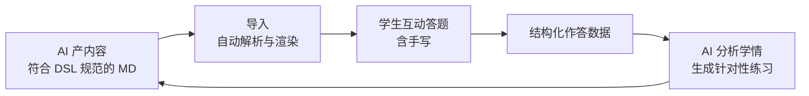

simple-tutor-tool 是我们的一个个人项目，一个给线上一对一辅导老师用的**自部署、AI 原生**讲练工具。

它最初只是为了解决一个日常麻烦：讲义散在各个文档里，每个学生的做题情况全靠脑子记。后来在一轮轮真实使用中，它逐渐长成了现在的样子——把**讲、练、批、析**串成一条完整的链路。

<CardGroup cols={2}>
  <Card title="在线体验" icon="play" href="http://47.116.99.166/">
    部署在云服务器的演示环境，内含演示数据，可完整走一遍讲义与答题流程。
  </Card>
  <Card title="GitHub 仓库" icon="github" href="https://github.com/LIziak112/simple-tutor-tool">
    开源项目（MIT），含架构、部署、DSL 规范等完整文档与样例。
  </Card>
</CardGroup>

## 一条链路串起讲与练

工具的主线可以用一张图概括：



老师（可以借助 AI）按规范写好 Markdown，导入即自动渲染成可互动的讲义与练习；学生打开链接就能答题，包括用 Apple Pencil 手写作答；老师随后在后台看到每个学生逐题的作答、原始笔迹与学情总结；这些结构化数据还能整包交回 AI，帮助准备下一节课。

这条链路的核心资产是**贯穿两端的数据结构契约**——同一份 Zod schema 由前端、后端与导出文件共用。上游，符合契约的 MD 能被自动转成讲义与练习；下游，作答数据是结构化 JSON，AI 可以直接消费。「内容怎么进」和「数据怎么出」都有明确的规范，这正是 AI 能深度参与的前提。

## 内容引擎：MD 进，互动页面出

- **导入即用**：讲义、练习册或两者混合的 `.md` 一次导入，自动识别类型、解析、上架，中间零手工整理。
- **自动结构化**：练习自动拆成题库（单元、题号、题型、难度、考点、答案、详解）；讲义按「第 X 讲」自动分篇。
- **互动渲染**：Markdown 与数学公式（KaTeX，本地打包不走 CDN）自动排版；讲解默认折叠、点击展开，答案与详解交卷后才出现。
- **Markdown DSL**：`:::` 容器指令等扩展语法统一由指令注册表管理，已发布指令只增不改，旧内容永远可用。
- **内置 linter**：`tutor-lint` 校验 DSL 文档，错误信息可以直接回喂给 AI 修正。教师端编辑器也带实时诊断。

## 学生端：打开链接就能答题

- **零负担进入**：浏览器打开专属链接，或用姓名 + 密码登录；免安装、免注册，iPad 可以「添加到主屏幕」全屏使用（PWA）。
- **线上答题**：判断 / 选择 / 填空 / 手写；数学答案可用虚拟键盘输入；Apple Pencil 手写会保留笔迹原图。
- **即时反馈**：客观题交卷即由服务端权威判分；填空与手写题进入教师批改队列。
- **记录沉淀**：每次练习的时间、得分、逐题对错随时翻阅；错题本带轮次史与攻克标准，可一键重练。
- **草稿防丢**：作答草稿存在本地 IndexedDB，刷新或锁屏后恢复。

## 教师端：内容是资产，数据是反馈

- **多教师域隔离**：各教师的资源库、课程、作业与学生完全隔离；管理端负责账号、注册开关与教师间共享目录。
- **资源库与导入向导**：单元 / 讲义的导入、预览、编辑、排序与软删除；导入有 lint 门禁、dry-run 预览与按文件选择。
- **课程与作业**：建课、学生名单、布置作业向导——每单元一份，或合并成一份。
- **批改**：填空 / 手写题逐题批注对错并写评语，参考答案以 LaTeX 渲染。
- **作答数据**：按学生查看每次提交——逐题答案、判分结果、每题用时、手写原图。
- **学情分析**：掌握度矩阵、周趋势、重点考点、题目统计与学生画像，为下一节课讲什么提供直接依据。
- **导出与备份**：提交记录导出 CSV；一键下载完整备份 zip，恢复前自动快照、可回滚。

## AI 原生：三层接入

「AI 原生」在这个项目里不是「界面上有个 AI 按钮」，而是三个层面的接口：

| 层 | 接入方式 |
| --- | --- |
| 制作端（AI 产内容） | DSL 规范 + 提示词模板 + linter，经 `/spec` 路由对外提供。把规范交给任何 AI，它产出的 MD 即可直接导入——老师从「写材料」变成「审材料」。 |
| 数据端（AI 读数据） | 一键导出「AI 学情数据包」：结构化作答数据 + 预置提示词，交给 AI 即得错误分布、薄弱考点与下节课建议。 |
| 实时接入（MCP Server） | 内置 MCP（`/mcp`，教师 API Token 鉴权）：Claude 等 AI 客户端可以直接列学生、取学情包、写报告、校验并导入内容。 |

制作端的这套资产还打包在仓库的 `dsl-kit/` 目录（DSL 规范、完整样例、提示词模板与离线校验脚本），拷给自己的 AI 工具即可离线使用。

## 单进程、数据自持

部署形态刻意保持简单：一个 Node 进程同时提供教师端、学生端与全部 API；数据就是本机 `data/` 目录里的一个 SQLite 文件加 blobs 目录（笔迹原图、备份都在内），不经任何第三方平台，**备份 = 复制目录**。

技术上：TypeScript（strict，禁 `any`）· React 19 · Hono · better-sqlite3 · Zod v4；单元测试 2300+，Playwright E2E 覆盖 Chromium 与 iPad 模拟，CI 全绿才可合并。

另有几条质量红线：

- **防泄题**：学生端 API 永不返回未交卷题目的答案、详解、提示。
- **判分只在服务端**执行，客户端结果不可信。
- **契约优先**：数据结构改动先改 `packages/contract`，禁止前后端各自手写同一类型。
- **DSL 兼容**：历史样例是兼容性回归测试，任何改动后必须仍能解析、渲染一致。

## 在线体验

演示环境部署在云服务器（`http://47.116.99.166/`），内含演示数据，会不定期重置，请勿录入真实学生信息。

<Steps>
  <Step title="学生端">
    打开[学生登录页](http://47.116.99.166/s/login)，用姓名「测试」+ 密码 `12345678` 登录。
  </Step>
  <Step title="教师端">
    打开[教师登录页](http://47.116.99.166/t/login)，登录名 `demo`，密码 `12345678`。
  </Step>
  <Step title="走一遍完整链路">
    学生交卷后，用教师账号进入 **数据** 页：逐题作答、手写原图与学情分析都在那里。
  </Step>
</Steps>

<Note>
线上地址为 HTTP 直连，仅供体验。正式使用建议自己部署，数据掌握在自己手里。
</Note>

## 自部署

Docker Compose 一条命令起完整服务：

```bash
git clone https://github.com/LIziak112/simple-tutor-tool.git && cd simple-tutor-tool
mkdir -p data && sudo chown -R 1000:1000 data
docker compose up -d --build
```

不想本地构建时，也可以直接用 CI 推送到 GHCR 的镜像：

```bash
docker run -d -p 8787:8787 -v ./data:/app/data ghcr.io/liziak112/simple-tutor-tool
```

数据全部落在挂载的 `./data` 目录。公网部署后，建议在管理端关闭教师自助注册。

---

这个项目可以看作站内几篇思考的又一次落地：学习过程的数据值得被结构化地留下来，老师和 AI 各有擅长的事。相关的文章：

- [AI时代下考研教师IP价值的简单思考](/blog/ai-era-teacher-ip)：信任、学习方法，以及对学习过程的支持。
- [AI 时代教辅机构的思考](/blog/ai-era-education-company)：AI 时代教育服务的价值与长期积累。
- [英语做题方法 Demo](/blog/xiebinbin-demo)：把做题过程记录下来、让检验成为教学一部分的另一个尝试。
